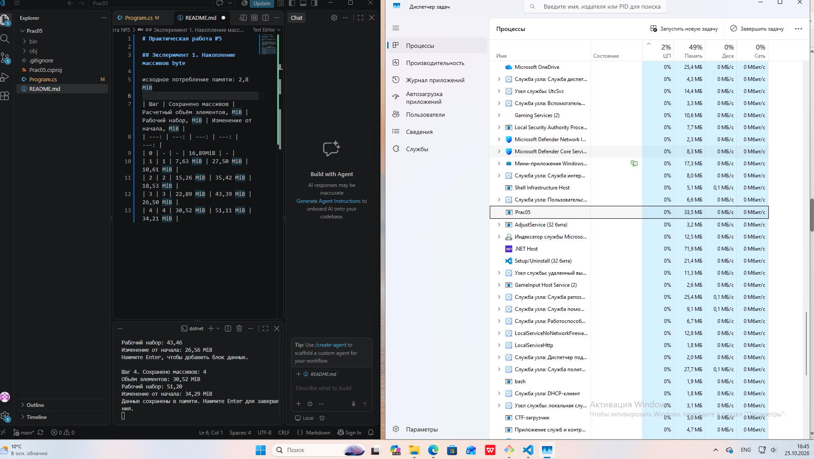
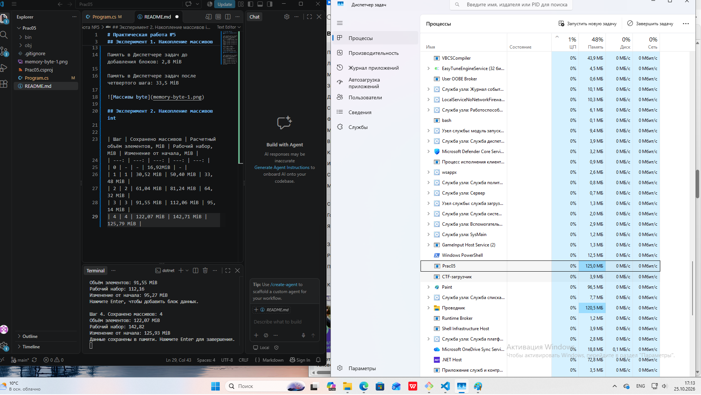

# Практическая работа №5

## Эксперимент 1. Накопление массивов byte

| Шаг | Сохранено массивов | Расчетный объём элементов, MiB | Рабочий набор, MiB | Изменение от начала, MiB |
| ---: | ---: | ---: | ---: | ---: |
| 0 | - | - | 16,89MiB | - |
| 1 | 1 | 7,63 MiB | 27,50 MiB | 10,61 MiB |
| 2 | 2 | 15,26 MiB | 35,42 MiB | 18,53 MiB |
| 3 | 3 | 22,89 MiB | 43,39 MiB | 26,50 MiB |
| 4 | 4 | 30,52 MiB | 51,11 MiB | 34,21 MiB |  

Память в Диспетчере задач до добавления блоков: 2,8 MiB

Память в Диспетчере задач после четвертого шага: 33,5 MiB

## Эксперимент 2. Накопление массивов int

| Шаг | Сохранено массивов | Расчетный объём элементов, MiB | Рабочий набор, MiB | Изменение от начала, MiB |
| ---: | ---: | ---: | ---: | ---: |
| 0 | - | - | 16,92MiB | - |
| 1 | 1 | 30,52 MiB | 50,40 MiB | 33,48 MiB |
| 2 | 2 | 61,04 MiB | 81,24 MiB | 64,32 MiB |
| 3 | 3 | 91,55 MiB | 112,06 MiB | 95,14 MiB |
| 4 | 4 | 122,07 MiB | 142,71 MiB | 125,79 MiB | 

Сравнение byte и int с числами из таблиц: каждое значение byte в несколько раз значений int.

Почему память процессора и размер элементов различаются: Потому что byte = 1 байта, а int = 4 байта - поэтому расчётный объём int в 4 разабольше byte

## Эсперимент 3. Разнфе значения элементов
 
| Знчение элемента | Расчетный объём элементов, MiB | Рабочий набор, MiB | Изменение от начала, MiB | Контрольная суммма |
| ---: | ---: | ---: | ---: | ---: |
| 1 | 122,07 MiB | 142,71 MiB | 125,79 MiB | 4 |
| 1 000 000 | 122,07 MiB | 142,87 MiB | 125,95 MiB | 4 000 000 |
| 1 000 000, повтор | 122,07 MiB | 142,88 MiB | 125,93 MiB | 4 000 000 |

Изменение значения е показало значительных изменений, кроме контрольой суммы которая изменилась с 4 до 4 000 000.

Два одинаковых запуска ничего не показали.

Прежние массивы не возвращаются при новом запуске потому, что память не сбрасывается при завершении команды.

На накопителе остается скомпилированные файлы и файл, который мы создали.

## Вывод
 При сохранении программой все большего количества данных оперативная память постепенно растёт.
